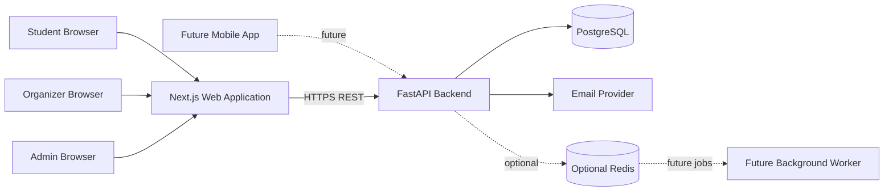

# CampusLoop — Technical Requirements Document

**Version:** 1.1  
**Status:** Draft baseline  
**Architecture direction:** Modular monolith  
**Initial deployment scope:** Single college

---

## 1. Purpose

This document translates the product requirements into a proposed technical architecture, implementation structure, security model, and engineering constraints for CampusLoop.

The architecture is intentionally simple for an initial campus pilot while preserving clear module boundaries for future growth.

## 2. Architecture overview

CampusLoop will begin as a modular monolith.

- One backend application exposes versioned REST APIs.
- One relational database stores application data.
- The web frontend communicates with the backend over HTTPS.
- A future mobile client will consume the same backend APIs.
- Background processing and caching can be introduced when real requirements justify them.

Microservices are not part of the initial architecture.

### 2.1 High-level component view



## 3. Proposed technology stack

| Layer | Technology | Responsibility |
|---|---|---|
| Web frontend | Next.js | Responsive web application |
| Language | TypeScript | Frontend type safety |
| Styling | Tailwind CSS | UI styling |
| Backend | Python + FastAPI | REST API and business logic |
| Database | PostgreSQL | Persistent relational data |
| ORM | SQLAlchemy | Database access |
| Migrations | Alembic | Versioned schema changes |
| API contract | OpenAPI | API documentation |
| Containers | Docker | Consistent local and deployment environments |
| Cache/queue | Redis (later) | Add only when needed |
| Mobile (later) | React Native + Expo | Mobile client using the same API |

Versions should be pinned and upgraded deliberately during implementation.

## 4. Backend design

### 4.1 Modular boundaries

Suggested backend modules:

- `auth`: registration, email verification/resend, login, refresh, logout, password reset.
- `users`: user profile and student-facing account data.
- `colleges`: college records, approved email domains, and college settings.
- `organizers`: organizer membership, club association, and trust status.
- `events`: event creation, editing, publication, lifecycle, and discovery.
- `registrations`: registration, cancellation, capacity enforcement, and participant queries.
- `approvals`: college-level event review and decision records.
- `admin`: college and platform administration.
- `notifications`: email and future notification workflows.
- `common`: shared configuration, database session, errors, logging, and security helpers.

Modules should own their domain logic. Avoid putting all business rules in route handlers.

### 4.2 Suggested folder structure

```text
backend/
  app/
    main.py
    core/
      config.py
      security.py
      errors.py
      logging.py
    db/
      base.py
      session.py
    modules/
      auth/
        router.py
        schemas.py
        models.py
        service.py
      users/
      colleges/
      organizers/
      events/
      registrations/
      approvals/
      admin/
      notifications/
    tests/
  alembic/
  alembic.ini
  pyproject.toml
  Dockerfile
```

The exact structure may evolve as implementation reveals the right boundaries.

## 5. API conventions

- Base path: `/api/v1`
- Use resource-oriented REST endpoints.
- Use JSON request and response bodies unless a file upload/download is required.
- Use appropriate HTTP methods and status codes.
- Validate input using typed request schemas.
- Keep public response schemas separate from database models.
- Return consistent error structures.
- Document endpoints through FastAPI OpenAPI output.

Example error response:

```json
{
  "error": {
    "code": "REGISTRATION_CLOSED",
    "message": "Registration for this event is closed."
  }
}
```

Do not expose stack traces, SQL details, secrets, or internal implementation information in production responses.

## 6. Proposed API surface

The following routes are a planning baseline. Request/response schemas, query parameters, pagination, and exact status codes will be specified in a separate API specification before implementation.

### 6.1 Authentication

| Method | Endpoint | Purpose |
|---|---|---|
| POST | `/api/v1/auth/register` | Create an account |
| POST | `/api/v1/auth/verify-email` | Verify email ownership and assign college affiliation |
| POST | `/api/v1/auth/resend-verification` | Request a replacement verification message |
| POST | `/api/v1/auth/login` | Authenticate |
| POST | `/api/v1/auth/refresh` | Rotate refresh token and issue access token |
| POST | `/api/v1/auth/logout` | Revoke session/refresh token |
| POST | `/api/v1/auth/forgot-password` | Start password reset |
| POST | `/api/v1/auth/reset-password` | Complete password reset |

### 6.2 Student and user

| Method | Endpoint | Purpose |
|---|---|---|
| GET | `/api/v1/users/me` | Current user profile |
| PATCH | `/api/v1/users/me` | Update permitted profile fields |
| GET | `/api/v1/users/me/registrations` | Current user's registrations |

### 6.3 Events

| Method | Endpoint | Purpose |
|---|---|---|
| GET | `/api/v1/events` | Browse published events |
| GET | `/api/v1/events/{event_id}` | Event details |
| POST | `/api/v1/events` | Create event draft |
| PATCH | `/api/v1/events/{event_id}` | Update authorized event |
| POST | `/api/v1/events/{event_id}/submit` | Submit for approval |
| POST | `/api/v1/events/{event_id}/publish` | Publish when policy permits |
| POST | `/api/v1/events/{event_id}/cancel` | Cancel event |
| POST | `/api/v1/events/{event_id}/revisions` | Submit a material edit to an approved event for review |

### 6.4 Registrations

| Method | Endpoint | Purpose |
|---|---|---|
| POST | `/api/v1/events/{event_id}/registrations` | Register current student |
| GET | `/api/v1/events/{event_id}/registrations` | List participants for authorized organizer/admin |
| GET | `/api/v1/registrations/me` | List current user's registrations |
| POST | `/api/v1/registrations/{registration_id}/cancel` | Cancel own registration |

### 6.5 Organizer workspace

| Method | Endpoint | Purpose |
|---|---|---|
| GET | `/api/v1/organizer/events` | List events managed by organizer |
| GET | `/api/v1/organizer/dashboard` | Organizer dashboard data |
| GET | `/api/v1/organizer/events/{event_id}/export` | Export authorized participant list |
| GET | `/api/v1/organizer/events/{event_id}/revisions` | List revisions for a managed event |

### 6.6 College administration

| Method | Endpoint | Purpose |
|---|---|---|
| GET | `/api/v1/admin/events/pending` | List pending events in college scope |
| POST | `/api/v1/admin/events/{event_id}/approve` | Approve event |
| POST | `/api/v1/admin/events/{event_id}/reject` | Reject initial event submission |
| GET | `/api/v1/admin/event-revisions/pending` | List pending material event revisions |
| POST | `/api/v1/admin/event-revisions/{revision_id}/approve` | Approve a material event revision |
| POST | `/api/v1/admin/event-revisions/{revision_id}/reject` | Reject a material event revision |
| GET | `/api/v1/admin/organizers` | List organizer profiles and memberships |
| POST | `/api/v1/admin/organizers` | Grant organizer access and club membership |
| DELETE | `/api/v1/admin/organizers/{organizer_id}/memberships/{membership_id}` | Revoke a club membership (soft revoke) |
| POST | `/api/v1/admin/organizers/{organizer_id}/trust` | Grant/revoke trusted status |

These endpoint names may be refined to maintain consistent resource semantics. Administrative actions must create auditable records.

## 7. Data and database requirements

PostgreSQL is the source of truth.

The database design must account for:

- Users and verified email identities
- Colleges and approved email domains
- Organizer memberships and club associations
- Separate organizer role and trusted-publisher status
- Events and event lifecycle
- Registrations and registration status
- Approval decisions and audit history
- Refresh-token/session records
- Timestamps and ownership metadata

### 7.1 Integrity requirements

- Use foreign keys for relational integrity.
- Add uniqueness constraints for verified identity and active registration rules where appropriate.
- Index common event discovery filters and ownership lookups.
- Use transactions for registration, event state changes, revision approvals, organizer membership revocation, and audit-log writes.
- Use migrations for all schema changes.
- Store timestamps consistently in UTC; convert to the user's locale at the presentation layer.

### 7.2 Registration capacity

Capacity enforcement must be performed by the backend and database, not by a frontend-only availability check.

The registration operation should execute transactionally so two concurrent requests cannot both claim the final available seat. The final implementation should choose and test an appropriate locking or atomic-update strategy.

## 8. Authentication and authorization

### 8.1 Authentication

Proposed approach:

- Hash passwords with Argon2id using a maintained implementation and safe parameters.
- Issue short-lived access tokens.
- Use refresh-token rotation and server-side revocation/session tracking.
- For web, prefer secure, HttpOnly, SameSite cookies for refresh/session credentials.
- Apply CSRF protections where cookie-based authentication requires them.
- Never store plaintext passwords or long-lived secrets in browser local storage.
- Rate-limit login, verification, and password-reset endpoints.

Token lifetimes and cookie settings must be finalized for the deployment environment.

### 8.2 Authorization

Use role-based access control together with resource ownership and college scope.

Roles:

- `STUDENT`
- `ORGANIZER`
- `COLLEGE_ADMIN`
- `PLATFORM_ADMIN`

Trusted-publisher status is a separate organizer attribute, not a role.

Every protected backend operation must verify:

1. The caller is authenticated.
2. The caller has the required role or permission.
3. The target resource belongs to an allowed college or scope.
4. The caller has ownership or assignment rights where required.
5. The requested state transition is valid.

Hiding a button in the frontend is not authorization.

## 9. Security requirements

- Enforce HTTPS in deployed environments.
- Validate and normalize inputs.
- Use parameterized database access through the ORM.
- Configure CORS narrowly for known frontend origins.
- Apply rate limits to sensitive endpoints.
- Protect against brute-force login and verification abuse.
- Use secure password reset tokens with expiry and one-time use.
- Keep secrets in environment variables or a secrets manager.
- Avoid logging passwords, tokens, or unnecessary personal data.
- Restrict participant exports to authorized organizers and administrators.
- Audit approvals, rejections, trust changes, and other sensitive administrative actions.
- Define retention and deletion practices before collecting real student data.

## 10. Frontend requirements

- Use Next.js with TypeScript.
- Separate public, student, organizer, and admin route areas.
- Reuse components for event cards, status indicators, forms, and navigation.
- Provide loading, empty, success, and error states.
- Validate forms on the client for usability and again on the server for correctness.
- Do not treat client-side route guards as a security boundary.
- Keep API access in a dedicated client/service layer.
- Ensure responsive layouts and accessible controls.

## 11. Testing strategy

### Unit tests

- Domain validation and event lifecycle transitions
- Permission checks
- Registration eligibility rules
- Capacity calculations and business rules

### Integration tests

- Registration, email verification, and verification resend
- Event creation and approval
- Organizer membership revocation and role/trust cleanup
- Trusted and untrusted publishing paths
- Registration cancellation
- College-scope authorization
- Database constraints and migrations

### Concurrency tests

- Simultaneous requests for the final available seat
- Duplicate registration attempts
- Concurrent cancellation/registration edge cases

### Frontend tests

- Authentication and navigation states
- Event discovery and detail views
- Registration form validation
- Organizer event creation and participant views

Critical security and transactional behavior must be tested at the API/database level.

## 12. Deployment and environments

Recommended environments:

- Local development
- Staging/testing
- Production

Use Docker for reproducible local and deployment environments. Configure separate databases and credentials per environment.

Production readiness should include:

- HTTPS and secure cookie configuration
- Managed PostgreSQL or a properly maintained database host
- Automated backups and a tested restore procedure
- Application and database monitoring
- Structured logs without sensitive data
- Environment-specific secrets
- Database migration procedure
- Basic incident and rollback plan

## 13. Performance and scalability

The MVP should prioritize correctness and maintainability.

Initial considerations:

- Paginate event lists and participant lists.
- Add indexes based on actual query patterns.
- Avoid N+1 database access patterns.
- Keep event discovery queries bounded.
- Add caching only when measurement shows a need.
- Introduce Redis/background workers for high-volume notifications or asynchronous tasks when justified.

Do not introduce microservices or distributed infrastructure solely in anticipation of hypothetical scale.

## 14. Engineering standards

- Use Git branches and descriptive commits.
- Keep secrets and local environment files out of Git.
- Use linting and formatting tools.
- Type-check frontend code.
- Add automated tests for new business logic.
- Keep database migrations reviewable.
- Document non-obvious architecture decisions.
- Update API and product documentation when behavior changes.
- Prefer small, reviewable changes.

## 15. Implementation sequence

1. Repository setup, local development environment, and configuration.
2. Database schema and migrations.
3. Authentication and institutional email verification.
4. Roles, organizer membership, and college scope.
5. Event creation, editing, approval, and publishing.
6. Student event discovery and registration.
7. Organizer participant management and exports.
8. College administration workflows.
9. Security, concurrency, and end-to-end testing.
10. Staging deployment and controlled pilot.

---

**Document note:** This is a proposed technical baseline. API routes and architecture details are not implemented until corresponding code, tests, and deployment configuration exist.
