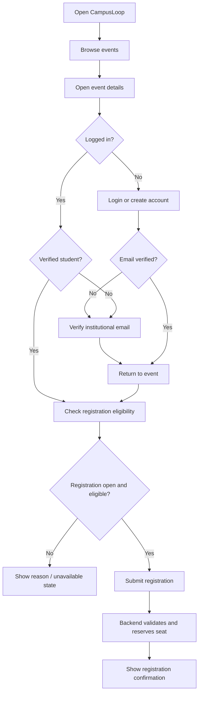
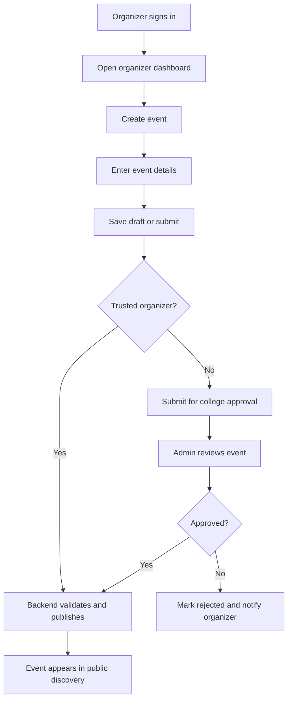
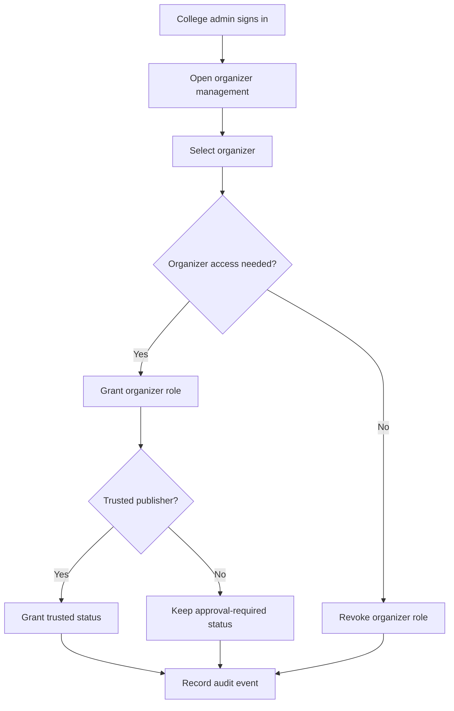

# CampusLoop — Application Flow

**Version:** 1.0  
**Status:** Draft baseline  
**Initial platform:** Responsive website

---

## 1. Purpose

This document describes the main screens, routes, navigation patterns, permissions, and user journeys for CampusLoop.

The initial release is a responsive website. A future mobile application should use the same backend APIs and preserve the same core business rules.

## 2. User roles

- **Visitor:** Unauthenticated user who can browse public events.
- **Student:** Verified institutional user who can register for events.
- **Organizer:** Explicitly authorized user who can manage assigned events.
- **College Admin:** Institutional administrator who manages approvals and organizer trust within their college.
- **Platform Admin:** Platform-level operator.

A student account does not automatically receive organizer permissions. Organizer privileges and trusted-publisher status are separate.

## 3. Route map

### 3.1 Public routes

| Route | Screen | Access |
|---|---|---|
| `/` | Home / event highlights | Public |
| `/events` | Event discovery and filters | Public |
| `/events/[eventId]` | Event details | Public |
| `/login` | Sign in | Public |
| `/register` | Student account registration | Public |
| `/verify-email` | Email verification result | Verification flow |

### 3.2 Student routes

| Route | Screen | Access |
|---|---|---|
| `/student/onboarding` | First-time profile setup | Verified student |
| `/student/dashboard` | Student overview | Student |
| `/student/events` | Browse events in student context | Student |
| `/student/my-events` | Registrations and event history | Student |
| `/student/profile` | Profile and account settings | Student |
| `/events/[eventId]/register` | Registration confirmation/action | Verified student |

### 3.3 Organizer routes

| Route | Screen | Access |
|---|---|---|
| `/organizer/dashboard` | Organizer overview | Organizer |
| `/organizer/events` | Managed events | Organizer |
| `/organizer/events/create` | Create event | Organizer |
| `/organizer/events/[eventId]` | Manage event | Assigned organizer |
| `/organizer/events/[eventId]/participants` | Participant list | Assigned organizer |

### 3.4 College administrator routes

| Route | Screen | Access |
|---|---|---|
| `/college-admin/dashboard` | College overview | College Admin |
| `/college-admin/approvals` | Pending event approvals | College Admin |
| `/college-admin/organizers` | Organizer access and trust | College Admin |
| `/college-admin/settings` | College configuration | Authorized College Admin |

### 3.5 Platform administrator routes

| Route | Screen | Access |
|---|---|---|
| `/platform-admin` | Platform overview | Platform Admin |

Route names are proposed and may change during frontend implementation. Authorization must always be enforced by the backend.

## 4. Navigation structure

### Visitor navigation

- Home
- Explore Events
- Login
- Create Student Account

### Student navigation

- Home / Discover
- My Events
- Profile
- Account menu / Logout

### Organizer navigation

- Dashboard
- My Events
- Create Event
- Account menu / Logout

### College Admin navigation

- Dashboard
- Pending Approvals
- Organizers
- College Settings
- Account menu / Logout

A user with multiple permissions may be offered a role-aware workspace switcher. The backend remains authoritative about the active permissions.

## 5. Screen requirements

### 5.1 Home page — `/`

Purpose: Explain the platform and help visitors discover events.

Main sections:

- CampusLoop introduction
- Featured or upcoming published events
- Event categories
- Call to action to explore events
- Sign-in and registration links

Behavior:

- Only public, published events should be shown.
- Event cards link to event detail pages.
- No login is required to browse.

### 5.2 Event discovery — `/events`

Purpose: Help users find relevant events.

Main elements:

- Search input
- Category filter
- Date filter
- Optional event-type or availability filter
- Event cards with title, date, venue, organizer, and registration status
- Pagination or incremental loading

States:

- Loading
- Results found
- No matching events
- Error / retry

### 5.3 Event detail — `/events/[eventId]`

Purpose: Provide all information needed to decide whether to attend.

Main elements:

- Event title and description
- Organizer/club
- Date and time
- Venue or online details
- Eligibility
- Registration window
- Capacity/availability when applicable
- Contact information
- Registration action

Behavior:

- Public visitors can read the event details.
- A visitor selecting Register is directed to sign in or create an account.
- A verified student can proceed to registration if eligible.
- Registration status and event lifecycle are checked by the backend at submission time.

### 5.4 Registration and verification

Proposed journey:

1. Student opens the registration page.
2. Student enters an institutional email and password.
3. Backend checks the email domain against configured college domains.
4. Verification link or code is sent.
5. Student completes verification.
6. Backend assigns college affiliation based on the verified email/domain configuration.
7. Student completes permitted profile details.
8. Student can register for eligible events.

Do not allow a user to select an arbitrary college as proof of affiliation.

### 5.5 Student dashboard — `/student/dashboard`

Main elements:

- Welcome / profile summary
- Upcoming registered events
- Recently published events
- Quick link to discover events
- Registration reminders or status information when available

### 5.6 My Events — `/student/my-events`

Main elements:

- Upcoming registrations
- Past events
- Cancelled registrations
- Event details and registration status

Behavior:

- Students see only their own registrations.
- Cancellation is shown only when permitted by event policy.
- The backend validates cancellation eligibility.

### 5.7 Organizer dashboard — `/organizer/dashboard`

Main elements:

- Events managed by the organizer
- Draft and pending events
- Published and completed events
- Registration counts
- Quick action to create an event

Organizer views must be restricted to assigned events and authorized club scope.

### 5.8 Create event — `/organizer/events/create`

Suggested form sections:

1. Basic information: title, description, category.
2. Schedule: start/end date and registration open/close times.
3. Venue: location or online-event details.
4. Participation: capacity and eligibility.
5. Organizer information: club and contact details.
6. Review: preview and save draft/submit.

Behavior:

- Drafts are not publicly discoverable.
- Trusted organizers may publish directly after validation.
- Untrusted organizers submit for approval.
- The UI should clearly show the resulting event status.

### 5.9 Event management — `/organizer/events/[eventId]`

Main elements:

- Event summary and status
- Edit event details
- Registration summary
- Participant management link
- Submit for approval / publish action where permitted
- Cancel event action where permitted

The backend validates ownership, role, trust status, and lifecycle transition.

### 5.10 Participants — `/organizer/events/[eventId]/participants`

Main elements:

- Participant list
- Registration timestamp and status
- Search/filter where useful
- Export action

Only authorized organizers and administrators may access participant information. Export actions should be auditable and limited to necessary fields.

### 5.11 College Admin dashboard

Main elements:

- Pending event count
- Published event overview
- Organizer overview
- Recent administrative activity

### 5.12 Event approvals — `/college-admin/approvals`

Main elements:

- Pending event queue
- Event detail preview
- Organizer identity and trust state
- Approve action
- Reject action with reason

Behavior:

- Admin can review events within their college scope.
- Approval/rejection records include actor, timestamp, and decision.
- Rejected events are not publicly visible.
- The organizer should be able to see the decision and any provided reason.

### 5.13 Organizer administration — `/college-admin/organizers`

Main elements:

- Organizer list
- Club association
- Organizer access status
- Trusted-publisher status
- Grant/revoke organizer access
- Grant/revoke trusted status

Behavior:

- Role and trust are managed independently.
- Changes require appropriate college-admin permission.
- Sensitive changes are recorded in an audit log.

## 6. Key user journeys

### 6.1 Visitor discovers and registers for an event

### 6.2 Organizer creates an event

### 6.3 College admin manages organizer trust

### 6.4 Student cancels a registration

1. Student opens My Events.
2. Student selects an upcoming registration.
3. UI displays cancellation availability and relevant policy.
4. Student confirms cancellation.
5. Backend verifies ownership and cancellation eligibility.
6. Registration status changes to `CANCELLED`.
7. UI refreshes the registration state.

## 7. Permission and navigation rules

- Public routes are accessible without authentication.
- Registration requires an authenticated and verified student.
- Organizer routes require an explicit organizer grant.
- Organizer access is scoped to assigned events/clubs.
- College Admin routes require college-admin permission and are college-scoped.
- Platform Admin routes require platform-admin permission.
- A user must not gain privileges by changing frontend route parameters or request payloads.
- Backend authorization is required even when the frontend hides restricted links.

## 8. Application states and feedback

Important states should be designed for:

- Loading and skeleton states
- Empty event lists
- Empty registration lists
- Form validation errors
- Email verification pending/expired
- Successful registration
- Registration closed
- Event full
- Duplicate registration
- Event pending approval
- Event rejected
- Event cancelled
- Permission denied
- Session expired
- Network/server error

Messages should explain what happened and, where possible, what the user can do next.

## 9. Responsive behavior

- Support mobile, tablet, and desktop web layouts.
- Keep primary actions accessible on small screens.
- Use readable event cards and forms at narrow widths.
- Avoid relying on hover-only interactions.
- Ensure tables such as participant lists have a usable mobile presentation.
- Provide keyboard-accessible navigation and form controls.

## 10. Future mobile application

A future React Native application should reuse:

- Authentication and authorization rules
- Event discovery APIs
- Registration APIs
- Organizer and admin domain rules where applicable

The mobile app should not duplicate core business logic. The backend remains the source of truth.

---

**Document note:** Routes and screen layouts are proposed product behavior. They are not evidence of implemented frontend pages or backend endpoints.
