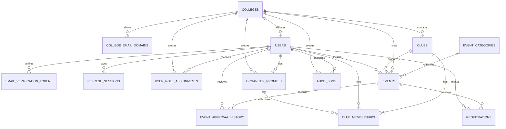

# CampusLoop Database Design

**Document:** 04 — Database Design  
**Version:** 1.0  
**Status:** Draft baseline  
**Database:** PostgreSQL  
**Scope:** Single-college MVP pilot at NIE Mysuru; schema designed so additional colleges can be onboarded later.

---

## 1. Purpose

This document defines the initial relational data model for CampusLoop. It translates the PRD, TRD, and Application Flow into database entities, relationships, constraints, and transaction rules.

The schema is intentionally designed for the MVP. It supports verified students, club-based organizers, trusted publishing, event approval, individual registrations, and college-level administration. Team registration, payments, attendance scanning, certificates, and waitlists are outside this version.

A documented schema is a design proposal. It becomes authoritative only after review and implementation testing.

## 2. Design principles

1. **College-scoped data:** college-owned records carry a `college_id` directly or through a parent relationship. Every read and write must be scoped and authorized by the backend.
2. **Separate identity from permissions:** a user account, verified college affiliation, organizer membership, and trusted-publisher status are distinct concepts.
3. **Database-enforced integrity:** use foreign keys, unique constraints, check constraints, and transactions rather than relying only on frontend validation.
4. **No premature denormalization:** calculate registration counts from registration rows in the MVP. Introduce cached counters only if measured performance requires them.
5. **Auditable administration:** record approvals, trust changes, and other important administrative actions.
6. **UTC storage:** store timestamps as PostgreSQL `timestamptz`; render them in the event's configured timezone.

## 3. Entity overview

| Module | Tables | Responsibility |
|---|---|---|
| Institution | `colleges`, `college_email_domains` | College identity and permitted institutional email domains |
| Identity | `users`, `email_verification_tokens`, `refresh_sessions` | Accounts, verification, and refresh-session lifecycle |
| Authorization | `user_role_assignments` | College-scoped and platform-level roles |
| Clubs | `clubs`, `club_memberships`, `organizer_profiles` | Clubs, organizer membership, and trusted-publisher status |
| Events | `event_categories`, `events`, `event_approval_history` | Event content, lifecycle, and approval trail |
| Participation | `registrations` | Individual student registrations |
| Governance | `audit_logs` | Security-sensitive and administrative activity |

Primary keys will use UUIDs. Table and column names use `snake_case`. SQLAlchemy models and Alembic migrations will implement this design.

## 4. Entity relationships

The diagram shows the principal relationships. Some relationships are optional at the row level; for example, an event may not yet have an approver while it is a draft.

## 5. Table specifications

### 5.1 `colleges`

Stores each participating institution.

| Column | Type | Rules |
|---|---|---|
| `id` | UUID | Primary key |
| `name` | VARCHAR(180) | Required |
| `slug` | VARCHAR(100) | Required, unique |
| `city` | VARCHAR(100) | Required |
| `state` | VARCHAR(100) | Required |
| `country_code` | CHAR(2) | Required; ISO 3166-1 alpha-2 |
| `timezone` | VARCHAR(64) | Required; default `Asia/Kolkata` for the pilot |
| `is_active` | BOOLEAN | Required; default true |
| `created_at`, `updated_at` | TIMESTAMPTZ | Required |

### 5.2 `college_email_domains`

Defines the institutional domains accepted for student verification.

| Column | Type | Rules |
|---|---|---|
| `id` | UUID | Primary key |
| `college_id` | UUID | FK → `colleges.id`, required |
| `domain` | VARCHAR(255) | Required; normalized lowercase, unique |
| `is_active` | BOOLEAN | Required; default true |
| `created_at` | TIMESTAMPTZ | Required |

A domain must be explicitly configured by an administrator. Do not accept arbitrary email suffixes supplied by a client. Domain ownership and institutional affiliation still require a verification process; a matching domain alone is not proof that an email address is controlled by the user.

### 5.3 `users`

Stores the account and basic profile. A user has at most one active college affiliation in the MVP.

| Column | Type | Rules |
|---|---|---|
| `id` | UUID | Primary key |
| `college_id` | UUID | FK → `colleges.id`, nullable until verified |
| `email` | VARCHAR(320) | Required; normalized lowercase |
| `password_hash` | VARCHAR(255) | Required; Argon2id hash, never plaintext |
| `full_name` | VARCHAR(160) | Required |
| `email_verified_at` | TIMESTAMPTZ | Nullable until verified |
| `account_status` | VARCHAR(20) | Required; `ACTIVE`, `SUSPENDED`, or `DELETED` |
| `created_at`, `updated_at` | TIMESTAMPTZ | Required |

Constraints:
- Unique index on normalized `email`.
- A verified student must have a college affiliation; enforce this in the verification transaction and with an appropriate check/trigger only if the chosen implementation can express the rule safely.
- Do not allow a client to set `college_id` directly during signup. The backend derives it from the verified, configured domain and the verification workflow.
- Account deletion should be a controlled deactivation/anonymization workflow, not an unrestricted cascading delete that destroys audit history.

### 5.4 `email_verification_tokens`

Stores one-time email verification challenges.

| Column | Type | Rules |
|---|---|---|
| `id` | UUID | Primary key |
| `user_id` | UUID | FK → `users.id`, required |
| `token_hash` | VARCHAR(255) | Required; unique |
| `expires_at` | TIMESTAMPTZ | Required |
| `consumed_at` | TIMESTAMPTZ | Nullable |
| `created_at` | TIMESTAMPTZ | Required |

Store only a cryptographic hash of the verification token. A token is valid only when it has not expired and `consumed_at IS NULL`. Consume it atomically so it cannot be reused. Expired and consumed tokens can be periodically purged according to the retention policy.

### 5.5 `refresh_sessions`

Tracks refresh-token sessions to support rotation and logout.

| Column | Type | Rules |
|---|---|---|
| `id` | UUID | Primary key |
| `user_id` | UUID | FK → `users.id`, required |
| `token_hash` | VARCHAR(255) | Required; unique |
| `expires_at` | TIMESTAMPTZ | Required |
| `revoked_at` | TIMESTAMPTZ | Nullable |
| `replaced_by_session_id` | UUID | Self-FK → `refresh_sessions.id`, nullable |
| `created_at` | TIMESTAMPTZ | Required |
| `user_agent` | TEXT | Optional |
| `ip_address` | INET | Optional; apply privacy and retention controls |

Refresh tokens are rotated on use. Reuse of an already-rotated token should trigger session-family revocation and security logging. Store token hashes, not raw refresh tokens.

### 5.6 `user_role_assignments`

Stores roles separately from the user account so one user can be a student and also hold organizer or college-admin privileges.

| Column | Type | Rules |
|---|---|---|
| `id` | UUID | Primary key |
| `user_id` | UUID | FK → `users.id`, required |
| `college_id` | UUID | FK → `colleges.id`, nullable only for platform-wide roles |
| `role` | VARCHAR(30) | `STUDENT`, `ORGANIZER`, `COLLEGE_ADMIN`, `PLATFORM_ADMIN` |
| `granted_by_user_id` | UUID | FK → `users.id`, nullable for controlled system bootstrap |
| `created_at` | TIMESTAMPTZ | Required |

Constraints:
- Unique on `(user_id, college_id, role)`, with PostgreSQL null-aware uniqueness handled explicitly (for example, a partial unique index for platform roles).
- `PLATFORM_ADMIN` must have `college_id IS NULL`; college-scoped roles must have a college.
- Only an authorized administrator or controlled bootstrap process can grant privileged roles.
- `STUDENT` is assigned after successful institutional email verification.
- Organizer access is additionally tied to club membership; a role assignment alone does not grant access to every club.

### 5.7 `clubs`

Represents a recognized student club or organizing body within a college.

| Column | Type | Rules |
|---|---|---|
| `id` | UUID | Primary key |
| `college_id` | UUID | FK → `colleges.id`, required |
| `name` | VARCHAR(160) | Required |
| `slug` | VARCHAR(120) | Required; unique within a college |
| `description` | TEXT | Optional |
| `contact_email` | VARCHAR(320) | Optional |
| `is_active` | BOOLEAN | Required; default true |
| `created_at`, `updated_at` | TIMESTAMPTZ | Required |

Unique constraint: `(college_id, slug)`.

### 5.8 `organizer_profiles`

Represents a user's organizer standing within a college. This is where trusted-publisher status is stored, separately from student verification and club membership.

| Column | Type | Rules |
|---|---|---|
| `id` | UUID | Primary key |
| `user_id` | UUID | FK → `users.id`, required |
| `college_id` | UUID | FK → `colleges.id`, required |
| `is_trusted_publisher` | BOOLEAN | Required; default false |
| `trusted_by_user_id` | UUID | FK → `users.id`, nullable |
| `trusted_at` | TIMESTAMPTZ | Nullable |
| `trust_note` | TEXT | Optional |
| `created_at`, `updated_at` | TIMESTAMPTZ | Required |

Unique constraint: `(user_id, college_id)`.

Trust can be granted or revoked only by an authorized college administrator. The change must also create an audit-log record. A trusted publisher may publish eligible events directly; trust does not bypass validation, cancellation rules, or moderation.

### 5.9 `club_memberships`

Links organizer profiles to clubs and defines what they can do within each club.

| Column | Type | Rules |
|---|---|---|
| `id` | UUID | Primary key |
| `club_id` | UUID | FK → `clubs.id`, required |
| `organizer_profile_id` | UUID | FK → `organizer_profiles.id`, required |
| `membership_role` | VARCHAR(20) | `OWNER`, `EDITOR`, or `VIEWER` |
| `is_active` | BOOLEAN | Required; default true |
| `granted_by_user_id` | UUID | FK → `users.id`, nullable |
| `created_at`, `updated_at` | TIMESTAMPTZ | Required |

Unique constraint: `(club_id, organizer_profile_id)`. The application must verify that the club and organizer profile belong to the same college. A composite foreign key can enforce this if the implementation adds matching unique keys on the parent tables.

### 5.10 `event_categories`

A small lookup table for consistent event classification.

| Column | Type | Rules |
|---|---|---|
| `id` | UUID | Primary key |
| `name` | VARCHAR(80) | Required; unique |
| `slug` | VARCHAR(90) | Required; unique |
| `is_active` | BOOLEAN | Required; default true |

Initial categories may include Technical, Cultural, Sports, Workshop, Seminar, and Other. Administrators can manage this list.

### 5.11 `events`

Stores the event itself and its current lifecycle state.

| Column | Type | Rules |
|---|---|---|
| `id` | UUID | Primary key |
| `college_id` | UUID | FK → `colleges.id`, required |
| `club_id` | UUID | FK → `clubs.id`, required |
| `category_id` | UUID | FK → `event_categories.id`, required |
| `created_by_user_id` | UUID | FK → `users.id`, required |
| `title` | VARCHAR(180) | Required |
| `summary` | VARCHAR(300) | Required |
| `description` | TEXT | Required |
| `venue` | VARCHAR(240) | Required for in-person events |
| `is_online` | BOOLEAN | Required; default false |
| `meeting_url` | TEXT | Optional; do not expose before permitted |
| `starts_at`, `ends_at` | TIMESTAMPTZ | Required; ends after starts |
| `registration_opens_at` | TIMESTAMPTZ | Required |
| `registration_closes_at` | TIMESTAMPTZ | Required |
| `timezone` | VARCHAR(64) | Required; default from college |
| `capacity` | INTEGER | Nullable for unlimited; if set, must be greater than zero |
| `status` | VARCHAR(30) | Required; lifecycle state |
| `rejection_reason` | TEXT | Nullable |
| `cancellation_reason` | TEXT | Nullable |
| `published_at` | TIMESTAMPTZ | Nullable |
| `created_at`, `updated_at` | TIMESTAMPTZ | Required |

Allowed statuses:
- `DRAFT`
- `PENDING_APPROVAL`
- `PUBLISHED`
- `REGISTRATION_CLOSED`
- `ONGOING`
- `COMPLETED`
- `CANCELLED`
- `REJECTED`

The backend validates allowed transitions. For example, a normal draft is submitted for approval; a trusted publisher can publish directly; an approved event moves through registration closed, ongoing, and completed. Cancellation is available only to authorized users and must be recorded.

The `college_id` on an event must match the college of its club. The creator must be an active member of that club with sufficient membership permissions. Enforce these cross-table rules in the service layer and, where practical, with composite foreign keys.

### 5.12 `event_approval_history`

Keeps a history of approval decisions rather than only storing the latest result on the event.

| Column | Type | Rules |
|---|---|---|
| `id` | UUID | Primary key |
| `event_id` | UUID | FK → `events.id`, required |
| `reviewed_by_user_id` | UUID | FK → `users.id`, required |
| `decision` | VARCHAR(20) | `APPROVED` or `REJECTED` |
| `comment` | TEXT | Optional |
| `created_at` | TIMESTAMPTZ | Required |

Each submission/review cycle can create a new history row. The current event status remains on `events`; the history table explains how it reached that state.

### 5.13 `registrations`

Stores individual student registrations. Team registration and waitlists are not part of this MVP.

| Column | Type | Rules |
|---|---|---|
| `id` | UUID | Primary key |
| `event_id` | UUID | FK → `events.id`, required |
| `student_user_id` | UUID | FK → `users.id`, required |
| `status` | VARCHAR(20) | `REGISTERED` or `CANCELLED` |
| `registered_at` | TIMESTAMPTZ | Required |
| `cancelled_at` | TIMESTAMPTZ | Nullable |
| `created_at`, `updated_at` | TIMESTAMPTZ | Required |

Constraints:
- Unique on `(event_id, student_user_id)` for the MVP. A cancelled registration row is retained and cannot be duplicated; re-registration can reactivate the same row if product policy permits.
- Student must be verified and affiliated with the same college as the event.
- Only published events within their registration window accept registrations.
- A cancellation updates the existing row; it does not erase the participation history.

## 6. Audit logging

### 6.1 `audit_logs`

Records important actions such as organizer trust changes, role grants/revocations, event approvals/rejections, and event cancellation.

| Column | Type | Rules |
|---|---|---|
| `id` | UUID | Primary key |
| `college_id` | UUID | FK → `colleges.id`, nullable for platform-wide actions |
| `actor_user_id` | UUID | FK → `users.id`, nullable only for controlled system actions |
| `action` | VARCHAR(100) | Required |
| `entity_type` | VARCHAR(80) | Required |
| `entity_id` | UUID | Required |
| `metadata` | JSONB | Optional; exclude passwords, tokens, and sensitive personal data |
| `created_at` | TIMESTAMPTZ | Required |

Audit rows should be append-only for application users. Restrict access to administrators and never log raw authentication tokens or passwords.

## 7. Important constraints and indexes

Create indexes for common filters and joins:

| Table | Index / constraint | Reason |
|---|---|---|
| `users` | Unique on normalized `email` | Login and duplicate-account prevention |
| `college_email_domains` | Unique on `domain`; index on `college_id` | Domain lookup and administration |
| `user_role_assignments` | Unique role assignment per user and scope; index on `(college_id, role)` | Authorization checks |
| `clubs` | Unique on `(college_id, slug)` | College-scoped club identity |
| `club_memberships` | Unique on `(club_id, organizer_profile_id)`; index on `organizer_profile_id` | Membership lookup |
| `events` | Index on `(college_id, status, starts_at)` | Public event discovery |
| `events` | Index on `(club_id, created_at)` | Organizer event dashboard |
| `events` | Check `ends_at > starts_at`; positive capacity when not null | Valid event data |
| `registrations` | Unique on `(event_id, student_user_id)` | Prevent duplicate registration |
| `registrations` | Index on `(student_user_id, status, registered_at)` | Student's registered events |
| `registrations` | Index on `(event_id, status)` | Participant lists and capacity checks |
| `event_approval_history` | Index on `(event_id, created_at)` | Approval history |
| `audit_logs` | Index on `(college_id, created_at)` and `(entity_type, entity_id)` | Audit investigation |

For frequently queried event lists, use pagination and stable ordering (for example, `starts_at, id`). Add partial indexes only after query patterns are measured.

## 8. Registration capacity: transaction rule

A simple count-then-insert without locking can oversubscribe an event when two requests arrive simultaneously. The registration service must perform the capacity check and registration write in one database transaction.

Recommended MVP approach:

1. Begin a transaction.
2. Lock the event row using `SELECT ... FOR UPDATE`.
3. Confirm the event is published and the current time is within the registration window.
4. Confirm the student is verified and belongs to the event's college.
5. Check whether the student already has a registration row.
6. Count rows with `status = 'REGISTERED'` for that event.
7. If capacity is set and the count has reached it, reject the request.
8. Insert the registration (or reactivate the existing cancelled row if re-registration is allowed).
9. Commit.

All registration creation paths must use this service/locking rule. The unique constraint remains a final defense against duplicate requests. If throughput later requires a counter-based approach, introduce it with a carefully tested atomic update and reconciliation job.

## 9. Authorization rules represented by the model

| Action | Required authorization |
|---|---|
| Browse published events | Public; college filter applies |
| Register for an event | Verified student in the same college |
| Create/edit a club event | Active club member with OWNER or EDITOR permission |
| Publish directly | Eligible active organizer with trusted-publisher status |
| Submit for approval | Eligible active organizer without trusted-publisher status |
| Approve/reject an event | College admin for that college |
| Grant/revoke organizer trust | College admin for that college |
| Manage college settings/domains | Authorized college admin |
| Platform-wide administration | Platform admin |

The frontend may hide unavailable actions, but the backend must independently enforce every rule. Never trust a role, college ID, organizer ID, or trust flag supplied by the client.

## 10. Deletion and retention policy

- Prefer soft deactivation for colleges, clubs, users, and categories where historical records depend on them.
- Do not cascade-delete events, registrations, approval history, or audit history when a user account is deactivated.
- Restrict deletion of parent records referenced by historical records.
- Define a retention and privacy policy before production deployment, especially for IP addresses, session metadata, and account deletion requests.
- Avoid collecting personal data that is not needed for the MVP.

## 11. Migration and implementation plan

1. Create SQLAlchemy models matching the approved schema.
2. Generate and review the initial Alembic migration.
3. Add foreign keys, unique constraints, check constraints, and indexes in migrations.
4. Seed the initial college, its verified email domain(s), and event categories through a controlled seed process.
5. Create the first college-admin account through a secure bootstrap command; never hardcode production credentials.
6. Add model and migration tests.
7. Add service tests for verification, role checks, approval transitions, and concurrent registration capacity.
8. Use test data to validate that one college cannot access another college's private organizer or administrative data.

## 12. Open decisions before implementation

These choices should be confirmed before finalizing the first migration:

| Decision | Proposed MVP default | Why it matters |
|---|---|---|
| Can a student re-register after cancelling? | Yes, reactivate the same registration row while registration is open | Preserves one row per student/event |
| Can one account belong to multiple colleges? | No; one active college affiliation in MVP | Keeps authorization and discovery simple |
| Can clubs have multiple owners? | Yes | Avoids a single-person bottleneck |
| Can an event be edited after approval? | Material edits return it to approval; minor edits may be allowed by policy | Prevents trusted content from changing unnoticed |
| Are external guests allowed to register? | No in MVP | Keeps the first release college-scoped |
| Are waitlists supported? | No in MVP | Avoids extra capacity and promotion workflows |

These defaults are recommendations, not already implemented behavior. Confirm them against the PRD before creating migrations.

## 13. Out of scope for v1.0

- Team registration and team-member tables
- Waitlists and automatic waitlist promotion
- Payments, refunds, and invoices
- Attendance/check-in QR codes
- Certificates
- Event feedback and ratings
- Notifications and notification-delivery logs
- Sponsorships and monetization records
- Multi-college memberships for one user

These can be added through later migrations without building them prematurely into the MVP.

---

**Next document:** API Specification — define endpoint contracts, request/response schemas, validation rules, authorization requirements, and error responses against this data model.
